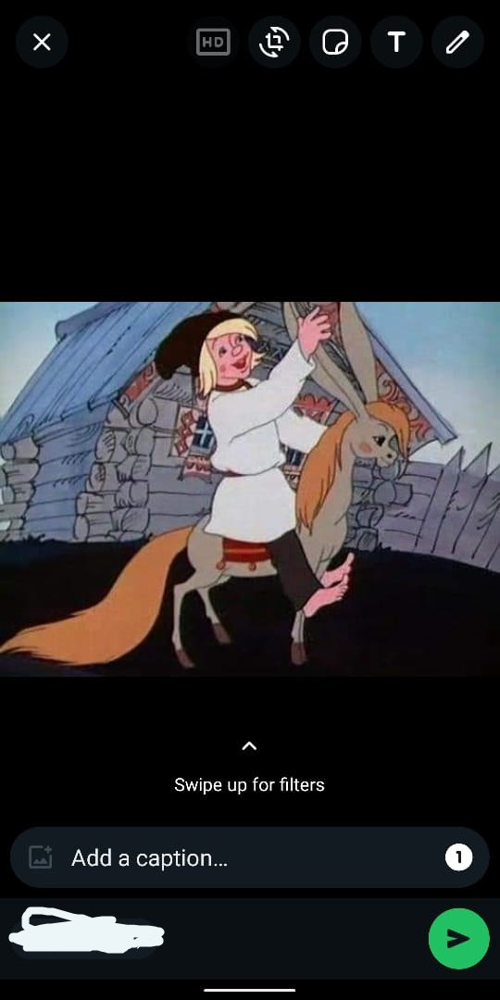
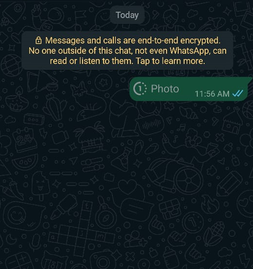
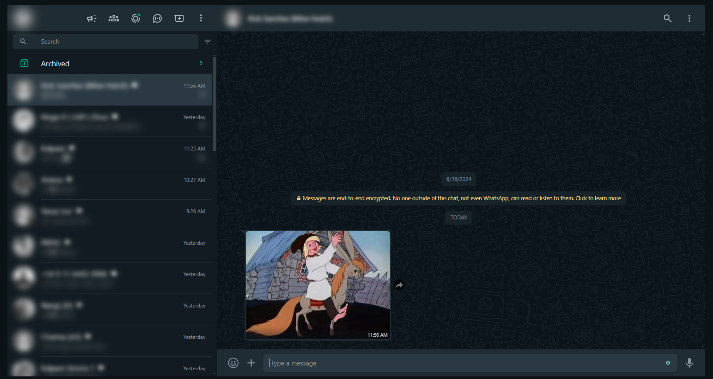

# WhatsApp View Once Bypass Chrome Extension


WhatsApp View Once Bypass is a Chrome extension that was designed to enhance WhatsApp Web functionality by allowing users to view and save photos marked as "view once", bypassing the app's view once restriction feature.

---

## ⚠️ CRITICAL UPDATE: Extension No Longer Functional (December 2025)

### Status: NOT WORKING - Server-Side Protection Prevents Bypass

**As of December 18, 2025**, this extension **no longer works** and **cannot be fixed** due to fundamental architectural changes in WhatsApp Web's security implementation.

### Why It No Longer Works

WhatsApp has implemented **server-side validation** for view-once messages. This means:

1. **Server-Side Enforcement**: When a message is marked as "view once", WhatsApp's servers refuse to send the actual message content to your browser until you access it from your phone.

2. **Content Not Transmitted**: Unlike other restrictions that can be bypassed at the client-level (browser/extension), view-once messages don't even reach your web browser. The server blocks transmission entirely.

3. **"Open on Your Phone" Message**: What you see in WhatsApp Web when someone sends a view-once message is literally the server's response saying "this content is restricted - open on your phone to view it."

4. **Client-Side Approaches Don't Work**: No amount of:
   - Modifying IndexedDB records
   - Hooking JavaScript functions
   - Intercepting network requests
   - Patching DOM elements
   - Can bypass server-side validation

### Technical Details

The extension attempted multiple bypass strategies:

#### Attempt 1: IndexedDB Modification
- **What I tried**: Modifying the `isViewOnce` flag in WhatsApp's IndexedDB database
- **Why it failed**: WhatsApp validates the flag on the server; modifying local data doesn't affect what the server sends to the browser
- **Result**: ❌ Failed

#### Attempt 2: JavaScript Object Patching
- **What I tried**: Hooking into WhatsApp's internal message objects and disabling view-once checks
- **Why it failed**: The message content simply isn't loaded into JavaScript objects if the server blocks it
- **Result**: ❌ Failed

#### Attempt 3: DOM Manipulation
- **What I tried**: Removing UI indicators and unhiding message content
- **Why it failed**: There's nothing to unhide - the content was never sent from the server
- **Result**: ❌ Failed

#### Attempt 4: Network Interception
- **What I tried**: Intercepting fetch/XHR calls to modify API responses and strip view-once flags
- **Why it failed**: WhatsApp's servers don't send message content if view-once is enabled; modifying local requests doesn't change server behavior
- **Result**: ❌ Failed

### Architecture Explanation

```
WhatsApp Server (Security Layer)
    ↓
    [Server checks: isViewOnce = true?]
    ↓
    YES → Returns: "Open on your phone" message (NO CONTENT)
    ↓
    [Browser receives empty/restricted response]
    ↓
    [Extension cannot work: no content to modify]


WhatsApp Server (if we could bypass)
    ↓
    [Server checks: isViewOnce = false?]
    ↓
    YES → Returns: Full message content
    ↓
    [Browser receives content]
    ↓
    [Extension could modify locally]
```

The security boundary is at the **server**, not the client.

---

## Original Features (No Longer Available)

These features worked in earlier versions but are now blocked by server-side validation:

- ❌ **Override View Once**: View photos marked for view once multiple times
- ❌ **Download Media**: Download media files set to disappear after single view
- ❌ **IndexedDB Integration**: Manage message statuses (no longer effective)

---

## Installation

The extension can still be installed and will load without errors, but it will **not function** for its intended purpose.

1. **Clone the repository:**
   ```bash
   git clone https://github.com/tharinduxd/whatsapp-view-once-bypass-chrome-extension.git
   ```

2. **Load the extension in Chrome:**
   - Open Google Chrome and go to `chrome://extensions/`
   - Enable Developer mode (toggle in top right corner)
   - Click "Load unpacked" and select the `whatsapp-view-once-bypass-chrome-extension` directory

3. **Note**: The extension will not bypass view-once messages due to server-side restrictions

---

## Technical Architecture

### Files Included

```
whatsapp-view-once-bypass-chrome-extension/
├── manifest.json           # Extension configuration
├── injector.js            # Content script that injects page scripts
├── script.js              # Main bypass logic (no longer functional)
├── moduleRaid.js          # Webpack module extraction tool
├── README.md              # Original README
├── FINAL_README.md        # This comprehensive file
└── _locales/en/
    └── messages.json      # Extension localization
```

### How It Worked (Before Server-Side Blocking)

1. **Manifest V3 Compliance**: Extension runs as a content script on WhatsApp Web
2. **Module Injection**: Loads moduleRaid.js to extract WhatsApp's internal webpack modules
3. **Message Interception**: Attempted to hook into message rendering pipeline
4. **Flag Modification**: Tried to disable view-once restrictions at various levels
5. **DOM Manipulation**: Attempted to remove UI indicators

### Why These Approaches Failed

All approaches failed at the same point: **the message content is never sent from the server** when view-once is enabled.

---

## Known Limitations

### Hard Limitations (Cannot Be Fixed)

1. **Server-Side Validation**: WhatsApp's servers check the view-once flag before transmitting message content
2. **No API Access**: Browser extensions have no privileged access to WhatsApp's API
3. **Encryption**: Message content is encrypted and controlled by WhatsApp's servers
4. **Authentication**: WhatsApp validates session tokens and enforces security policies server-side

### What Would Be Needed to Bypass

To actually bypass view-once would require:

- ❌ Access to WhatsApp's private encryption keys (impossible)
- ❌ WhatsApp's API with proper authorization (not available for this use case)
- ❌ Modifying WhatsApp's source code directly (not possible from browser extension)
- ❌ Phone-based access with proper authentication (different approach entirely)

---

## Why This Matters

WhatsApp's view-once feature is a **privacy feature** designed to:

- Protect sender privacy by ensuring ephemeral messages
- Prevent screenshots and permanent storage
- Comply with privacy regulations
- Respect user expectations

Attempting to bypass this feature:
- ⚠️ Violates WhatsApp's Terms of Service
- ⚠️ May violate local laws regarding unauthorized access
- ⚠️ Undermines sender privacy and trust
- ⚠️ Could result in account suspension

---

## Alternatives

If you need to view content that was sent as view-once:

1. **Ask the sender**: Request them to resend without view-once restriction
2. **Use WhatsApp on your phone**: View-once messages are designed to be viewed there
3. **Take screenshots on phone**: If the sender permits
4. **Use official WhatsApp API**: If you have proper authorization

---

## Contributing

While this extension cannot be fixed to bypass view-once, contributions are welcome for:

- Documentation improvements
- Educational purposes (understanding WhatsApp Web architecture)
- Other Chrome extension features

To contribute:

1. Fork the repository
2. Create a feature branch (`git checkout -b feature/improvement`)
3. Commit changes (`git commit -am 'Add improvement'`)
4. Push to branch (`git push origin feature/improvement`)
5. Open a Pull Request

---

## Lessons Learned

This project demonstrates important cybersecurity principles:

1. **Server-Side Security is Stronger**: Client-side restrictions can be bypassed, but server-side validation cannot
2. **Defense in Depth**: WhatsApp uses multiple security layers
3. **Encryption Matters**: Message content control at the server level
4. **Terms of Service Exist for Reasons**: Privacy features protect both users and services

---

## Frequently Asked Questions

**Q: Will this ever work again?**
A: No. WhatsApp's server-side validation is fundamental architecture, not a bug.

**Q: Can I use this on WhatsApp Desktop?**
A: Desktop uses the same WhatsApp Web backend; it will have the same limitations.

**Q: What if WhatsApp changes their code?**
A: It won't matter. Server-side validation prevents content from reaching any client.

**Q: Is there a way to bypass this?**
A: Not from a browser or extension. You would need access to WhatsApp's servers or API with proper authorization.

**Q: Should I uninstall this extension?**
A: Yes, it serves no purpose now and may waste system resources.

**Q: Will using this get my account banned?**
A: Unlikely, as it doesn't actually do anything. However, deliberately attempting to bypass WhatsApp's security could violate their ToS.

---

## Sample Output (Historical - Extension No Longer Works)

These screenshots show how the extension worked before server-side restrictions were implemented:

<div align="center">
  <table>
    <tr>
      <td align="center">
        <br>
        <sub>Phone View (Reference)</sub>
      </td>
      <td align="center">
        <br>
        <sub>Phone Screenshot</sub>
      </td>
      <td align="center">
        <br>
        <sub>Web Output (No Longer Works)</sub>
      </td>
    </tr>
  </table>
</div>

---

## Acknowledgements

- **Solo Developer**: [@tharinduxd](https://github.com/tharinduxd0) - Full project development, research, and implementation
- Special thanks to the community for testing and feedback

---

## License

This project is provided as-is for educational purposes. Use at your own discretion and risk.

---

## Conclusion

**This extension cannot work** because WhatsApp enforces view-once restrictions at the **server level**, before message content reaches the browser. No client-side modification (whether through extensions, userscripts, or browser tools) can overcome server-side security validation.

This is by design and serves important privacy purposes.

**Last Updated**: December 18, 2025  
**Status**: ❌ Non-Functional - Not Fixable  
**Reason**: Server-Side Architecture  
**Original Creator**: [@tharinduxd](https://github.com/tharinduxd0)  
**Repository**: [whatsapp-view-once-bypass-chrome-extension](https://github.com/tharinduxd0/whatsapp-view-once-bypass-chrome-extension)  

---

**For More Information**: See the GitHub issues section for technical discussions about why this limitation exists.
